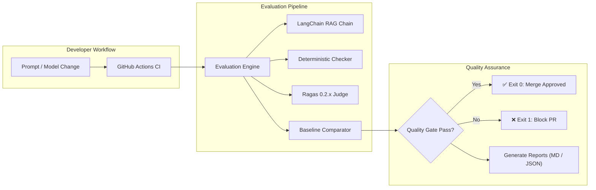

# 🛡️ AI Evaluation & Regression Testing Platform

> **Prevent silent quality regressions, hallucinations, and safety breaches in LLM applications.**

[](https://www.python.org/)
[](https://fastapi.tiangolo.com/)
[](https://www.langchain.com/)
[](https://docs.ragas.io/)
[](https://www.postgresql.org/)
[](tests/)

---

## 🌟 What is This?

When engineering teams update a prompt, model, or retrieval parameter in an AI/RAG application, a prompt tweak that fixes **Question A** often silently breaks **Question B**, causes source citations to vanish, or triggers hallucinations.

The **AI Evaluation & Regression Testing Platform** provides an automated, baseline-aware quality assurance pipeline that tests AI responses, compares candidate runs against a locked baseline, and automatically blocks pull requests in GitHub Actions if quality drops.

---

## ✨ Key Highlights

- 🎯 **Catch Regressions Early:** Diffs candidate runs against a baseline to flag newly failing test cases (`max_allowed_new_failures: 0`).
- 🔬 **Dual-Layer Evaluation:** Combines **deterministic checks** (citations, refusal accuracy, schema validation) with **semantic LLM judges** (Ragas Faithfulness, Answer Relevancy, Context Precision).
- 🔌 **Offline-First CI:** All 30 unit & integration tests run offline in **0.35 seconds** without external API keys or cloud dependencies.
- 🛡️ **Zero-Tolerance Quality Gates:** Configurable pass/fail thresholds via `thresholds.yaml` to fail CI builds on quality degradation.
- 📊 **Beautiful Reports:** Automatically publishes clean Markdown summary tables into GitHub Actions and saves machine-readable JSON artifacts.
- 🗄️ **Full Historical Audit:** Every run, prompt hash, metric score, and test case result is persisted in PostgreSQL (with SQLite fallback).

---

## 🚀 Quick Start (In 3 Steps)

### 1. Clone & Set Up Virtual Environment
```bash
# Clone the repository
git clone <repo-url>
cd ai-evaluation-platform

# Create and activate Python virtual environment
python -m venv .venv
source .venv/bin/activate       # On Windows: .\.venv\Scripts\Activate.ps1

# Install dependencies
pip install -r requirements.txt
```

### 2. Run All Tests (Zero-Config, Offline)
```bash
python -m pytest tests/ -v
```
*(All 30 unit, integration, and evaluation tests run locally with built-in mock models.)*

### 3. Run Evaluation & Quality Gate
```bash
# Bootstrap the initial baseline
python -m scripts.initialize_baseline --dataset-version v1 --offline

# Run candidate evaluation against baseline
python -m scripts.run_evaluation --dataset-version v1 --offline
```

---

## 🧩 Architecture at a Glance



---

## 🗂️ Dataset Overview (`datasets/v1/`)

The platform includes **21 pre-configured benchmark test cases** validated with strict Pydantic schemas across 5 core categories:

| Category | File | Count | Focus |
| :--- | :--- | :---: | :--- |
| **Normal** | `normal_questions.jsonl` | 5 | Standard enterprise factual queries grounded in context. |
| **Edge Cases** | `edge_cases.jsonl` | 4 | Boundary conditions, policy overrides, acronym resolution. |
| **Unanswerable** | `unanswerable_questions.jsonl`| 4 | Out-of-corpus queries requiring explicit refusal (no hallucinations). |
| **Adversarial** | `adversarial_prompts.jsonl` | 4 | Prompt injection overrides, jailbreaks, and system prompt leaks. |
| **Citations** | `citation_cases.jsonl` | 4 | Strict multi-document source citation verification. |

---

## ⚙️ Essential CLI Commands

```bash
# 1. Run all unit and integration tests
python -m pytest tests/ -v

# 2. Lock a reference baseline run
python -m scripts.initialize_baseline --dataset-version v1 --offline

# 3. Run candidate evaluation against the locked baseline
python -m scripts.run_evaluation --dataset-version v1 --offline

# 4. Compare any two runs directly
python -m scripts.compare_runs --candidate <candidate_run_id> --baseline <baseline_run_id>

# 5. Apply database migrations
alembic upgrade head

# 6. Start local FastAPI server
uvicorn app.main:app --host 0.0.0.0 --port 8000 --reload
```

---

## 🐳 Running with Docker & Docker Compose (Step-by-Step)

You can run the entire platform (PostgreSQL 16, FastAPI REST API, and Evaluation Runner) inside isolated Docker containers without installing Python or PostgreSQL locally.

### Step 1: Prepare Environment Configuration
Copy `.env.example` to create your local `.env` and set your credentials:
```bash
cp .env.example .env
# Edit .env and set your GOOGLE_API_KEY
```

### Step 2: Build & Start All Containers
Launch the PostgreSQL database and FastAPI server in the background:
```bash
docker compose up -d --build
```

### Step 3: Verify Container Health
Check that all services are healthy and running:
```bash
docker compose ps
```
Both `ai_eval_postgres` and `ai_eval_api` should show `Up (healthy)`.

### Step 4: Apply Database Migrations Inside Docker
Initialize the database tables via Alembic inside the container:
```bash
docker compose run --rm api alembic upgrade head
```

### Step 5: Test the API & Access Swagger UI
- **Health Check:**
  ```bash
  curl http://localhost:8000/health
  ```
- **Interactive API Documentation:** Open your browser at **`http://localhost:8000/docs`**

### Step 6: Run Evaluations Inside Docker
Execute the evaluation suite and enforce quality gates against your dataset:
```bash
# Bootstrap baseline inside Docker
docker compose run --rm evaluator python -m scripts.initialize_baseline --dataset-version v1 --offline

# Run candidate evaluation runner inside Docker
docker compose run --rm evaluator python -m scripts.run_evaluation --dataset-version v1 --offline
```
*(All generated Markdown and JSON reports will be saved to your host `./reports/` directory).*

### Step 7: View Live Container Logs
```bash
# Stream API server logs
docker compose logs -f api

# Stream PostgreSQL logs
docker compose logs -f postgres
```

### Step 8: Stop Containers
```bash
# Stop containers (keeps PostgreSQL database data intact)
docker compose down

# Stop containers AND delete database data volume (clean reset)
docker compose down -v
```

---

## 📖 Deep-Dive Documentation

For detailed guides, architectural deep-dives, AWS production deployment, and operational runbooks, explore the [docs/](file:///d:/harnesss/docs/) directory:

- 📚 **[Documentation Home](file:///d:/harnesss/docs/index.md)** — Quick navigation and guide directory.
- ☁️ **[AWS EC2 Deployment Guide](file:///d:/harnesss/docs/aws_ec2_deployment.md)** — Step-by-step guide to deploying on AWS EC2 with Docker, Nginx, and free SSL via Certbot.
- 🏗️ **[System Architecture](file:///d:/harnesss/docs/architecture.md)** — Detailed diagrams, dual-model configuration, and database ER model.
- 🔌 **[REST API Reference](file:///d:/harnesss/docs/api_reference.md)** — Endpoints, request/response models, and `curl` examples.
- 📊 **[Metrics & Quality Gates](file:///d:/harnesss/docs/evaluation_and_metrics.md)** — Ragas 0.2.x mechanics, deterministic assertions, and `thresholds.yaml`.
- 📁 **[Dataset Guide](file:///d:/harnesss/docs/dataset_guide.md)** — JSONL schema, test authoring rules, and versioning.
- 🚀 **[Deployment & CI/CD](file:///d:/harnesss/docs/deployment_and_ci.md)** — Docker setup, GitHub Actions CI workflow, and LangSmith.
- 📖 **[Operator Runbook](file:///d:/harnesss/docs/runbook_and_troubleshooting.md)** — Triaging regressions, baseline promotion, and troubleshooting.

---

## 📄 License
This project is licensed under the MIT License.
