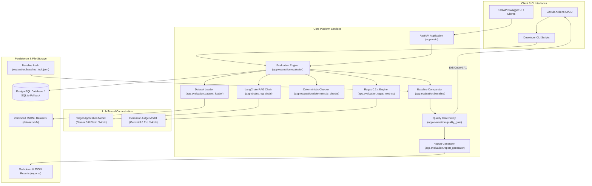
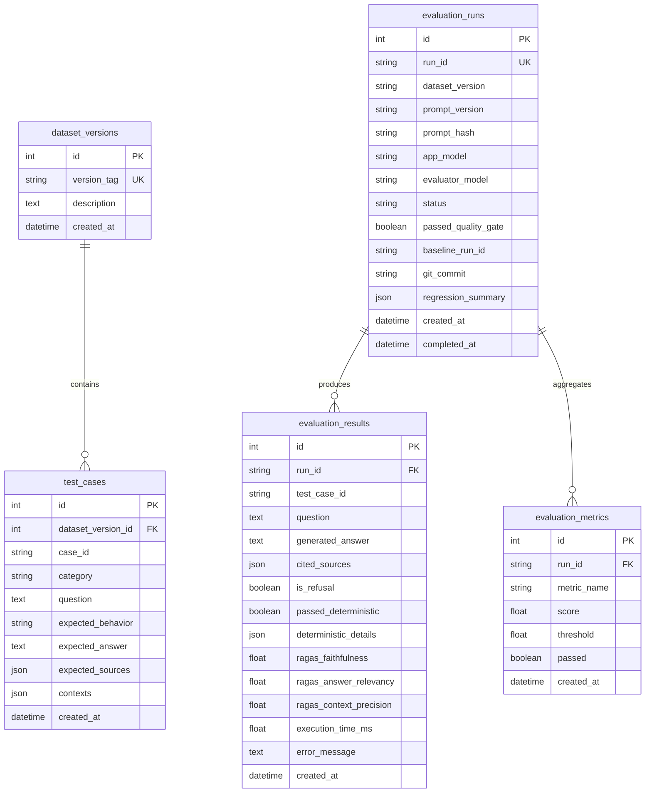

# 🏗️ System Architecture & Design

The **AI Evaluation & Regression Testing Platform** is structured into decoupled, modular layers separating target application logic, evaluation orchestration, persistence, API exposure, and CI/CD quality gate enforcement.

---

## 1. High-Level Architectural Diagram

---

## 2. Subsystem Breakdown

### 2.1 Reference Application Layer (`app/chains/`, `app/prompts/`)
- **[RAGChain](file:///d:/harnesss/app/chains/rag_chain.py):** Orchestrates prompts, retrieval, model invocation, and response parsing.
- **System Prompt Decoupling:** Stored in [system_prompt.txt](file:///d:/harnesss/app/prompts/system_prompt.txt). Tracks prompt version and generates dynamic SHA256 hashes for regression detection.
- **Modular Retrieval:** Implements `BaseRetriever` and `SuppliedContextRetriever`, enabling future vector database plugins (e.g., Pinecone, Chroma, pgvector) without modifying evaluation interfaces.
- **Structured Outputs:** Uses Pydantic to ensure predictable outputs containing:
  - `question`: User query.
  - `answer`: Grounded response text.
  - `source_identifiers`: Document tokens (e.g. `['sec-audit-101']`).
  - `citation_metadata`: Source ID and snippet mappings.
  - `is_refusal`: Explicit boolean indicating inability to answer from context.

### 2.2 Dual-Model Architecture (`app/services/llm_service.py`)
To prevent evaluator bias and conflicting generation settings, the platform separates the target application model from the evaluator judge model:

| Role | Default Model | Responsibility |
| :--- | :--- | :--- |
| **Application Model** | `gemini-3.8-flash` | Generates candidate answers grounded in context. |
| **Evaluator Judge Model** | `gemini-3.8-pro` | Independently scores Faithfulness, Relevancy, and Precision. |
| **Offline Mock Model** | `MockChatModel` | Deterministic simulation for local dev, offline tests, and CI. |

### 2.3 Evaluation & Quality Gate Pipeline
The evaluation cycle executes in 6 distinct steps:
1. **Dataset Loading:** Validates JSONL files in `datasets/<version>/` via [DatasetLoader](file:///d:/harnesss/app/evaluation/dataset_loader.py).
2. **Batch Inference:** Invokes the RAG chain on all test cases and records latency (`execution_time_ms`).
3. **Dual Metric Computation:**
   - **Deterministic:** Assertions on schema formatting, citation presence/validity, refusal compliance, and injection defense.
   - **Semantic (Ragas 0.2.x):** Computes Faithfulness, Answer Relevancy, and Context Precision.
4. **Baseline Regression Diffing:** Compares candidate results against a designated baseline run.
5. **Quality Gate Decision:** Compares actual metrics and regressions against [thresholds.yaml](file:///d:/harnesss/evaluation/thresholds.yaml).
6. **Persistence & Reporting:** Writes atomic records to PostgreSQL and renders Markdown and JSON reports.

---

## 3. Database Entity-Relationship (ER) Model

---

## 4. Security & Isolation Design

1. **Zero Credential Leakage:** Reports never include API keys, internal credentials, or secret tokens.
2. **Offline-First CI:** Unit tests, integration tests, and schema validators run with zero network access and no external API keys required.
3. **Database Portability:** Automatically detects PostgreSQL; if the PostgreSQL driver (`psycopg2`) is unavailable in a local lightweight development environment, it falls back to SQLite without breaking operations.
4. **Least-Privilege Docker Execution:** Container runs as non-root user `appuser:appgroup` (UID/GID 1001).
