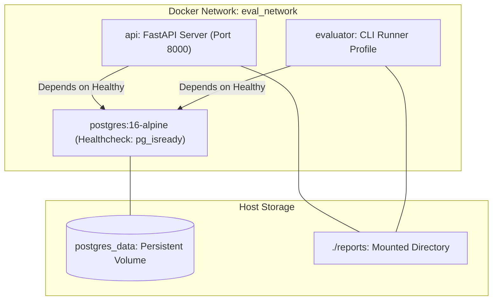
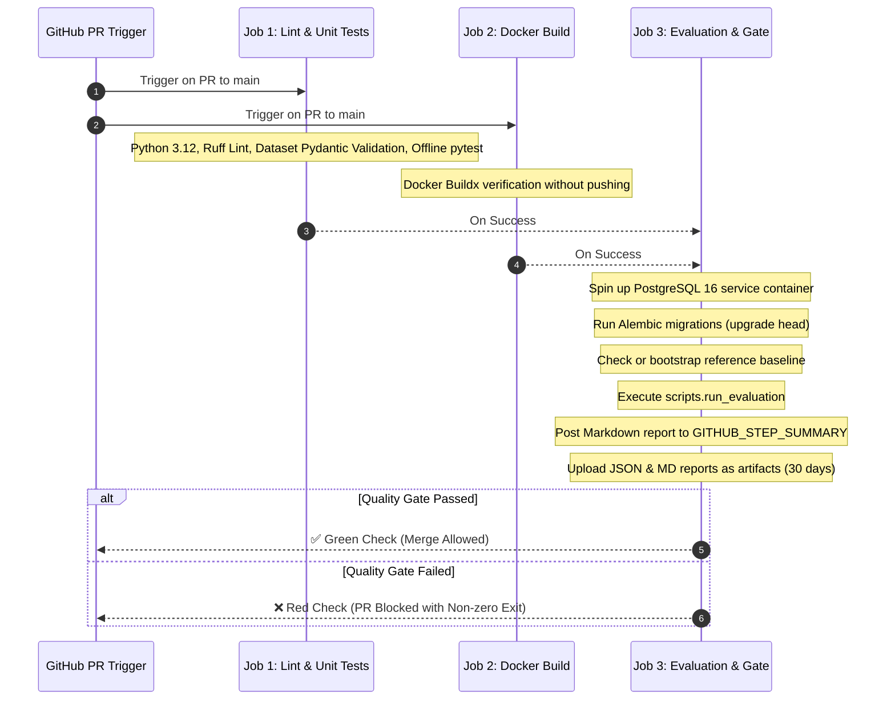

# 🚀 Deployment, Docker & CI/CD Guide

This guide details the containerization, database migration, and CI/CD automation procedures for the AI Evaluation & Regression Testing Platform.

---

## 1. Container Architecture (Docker & Docker Compose)

The platform includes a multi-stage Docker build producing a secure, lightweight runtime image running under a dedicated non-root user (`appuser:appgroup`, UID/GID 1001).

### Services in `docker-compose.yml`



### Docker Commands Cheat Sheet

#### Build Container Image
```bash
docker build -t ai-evaluation-platform:latest .
```

#### Start Database & API Services
```bash
docker compose up -d
```

#### Run Database Migrations Inside Container
```bash
docker compose run --rm api alembic upgrade head
```

#### Run Evaluation Runner Inside Container
```bash
docker compose run --rm evaluator python -m scripts.run_evaluation --dataset-version v1
```

#### Stop and Clean Up
```bash
docker compose down
```

---

## 2. Database Migrations (Alembic)

The platform tracks relational schema updates using Alembic.

### Common Migration Commands

| Command | Action |
| :--- | :--- |
| `alembic upgrade head` | Apply all pending migrations to target database. |
| `alembic downgrade -1` | Roll back the most recent migration revision. |
| `alembic current` | Display the active migration revision in the database. |
| `alembic history` | List historical migration scripts in chronological order. |
| `alembic revision -m "add_column"` | Generate an empty new migration script template. |

> [!TIP]
> `alembic.ini` and `migrations/env.py` dynamically read `DATABASE_URL` from the application settings or environment variables, allowing seamless switching between local SQLite, Docker Compose PostgreSQL, and cloud RDS instances.

---

## 3. GitHub Actions CI/CD Pipeline

The automated CI workflow is defined in [.github/workflows/llm-evaluation.yml](file:///d:/harnesss/.github/workflows/llm-evaluation.yml).

### Pipeline Workflow Stages



### GitHub Secrets Setup
To enable live evaluations with Google Gemini in CI:
1. Open your repository on GitHub.
2. Go to **Settings > Secrets and variables > Actions**.
3. Create the following repository secret:
   - `GOOGLE_API_KEY`: Your Gemini API Key.
   - `LANGCHAIN_API_KEY`: *(Optional)* Your LangSmith API key for experiment tracking.

> [!NOTE]
> If `GOOGLE_API_KEY` is not set in secrets, the CI pipeline automatically runs in **offline mock mode**, validating dataset schemas, deterministic assertions, and quality gate workflows without failing due to missing keys.

---

## 4. Optional LangSmith Experiment Tracking

To enable cloud tracing and dataset experiment tracking via LangSmith:

1. Add the following environment variables to `.env` or CI secrets:
   ```env
   LANGCHAIN_TRACING_V2=true
   LANGCHAIN_ENDPOINT=https://api.smith.langchain.com
   LANGCHAIN_API_KEY=your_langsmith_api_key_here
   LANGCHAIN_PROJECT=ai-evaluation-regression-platform
   ```
2. When active, every LangChain chain invocation and evaluator call automatically streams execution graphs, latency, and token consumption to your LangSmith project.
