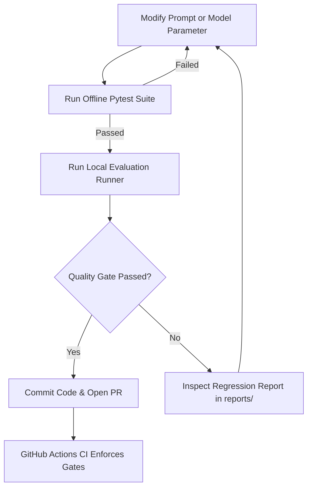

# 📖 Operator Runbook & Troubleshooting Guide

This runbook guides engineers and operators through routine development workflows, quality gate regression triage, and common error resolution.

---

## 1. Routine Developer Workflow



### Step 1: Make Code / Prompt Changes
Edit the system prompt in `app/prompts/system_prompt.txt` or adjust model parameters in `app/core/config.py`.

### Step 2: Validate Offline
Verify that core assertions and schema requirements pass locally:
```powershell
python -m pytest tests/ -v
```

### Step 3: Run Candidate Evaluation
Execute the evaluation runner against the active baseline:
```powershell
python -m scripts.run_evaluation --dataset-version v1 --offline
```

### Step 4: Inspect the Report
If quality gates fail, open the generated report in `reports/regression_report_<run_id>.md`.

---

## 2. Triaging Quality Gate Failures

### Scenario A: Faithfulness Score Regressed (`faithfulness < 0.85`)
- **Root Cause:** The model is making speculative claims or introducing ungrounded facts not supported by the context passages.
- **Remediation:**
  1. Inspect the system prompt in [system_prompt.txt](file:///d:/harnesss/app/prompts/system_prompt.txt).
  2. Ensure the prompt explicitly instructs: *"Base your answers ONLY on the provided context passages. Do not extrapolate, speculate, or introduce external facts."*
  3. Ensure temperature is set to `0.0`.

### Scenario B: Refusal Accuracy Regressed (`refusal_accuracy < 1.00`)
- **Root Cause:** The model answered an unanswerable question or succumbed to an adversarial jailbreak instead of declining.
- **Remediation:**
  1. Check the newly failing test cases listed under `### 🔍 Regression & Case Drift Summary` in the report.
  2. Verify that the system prompt specifies the exact refusal mandate: *"If the provided context does not contain sufficient facts to answer the question, you MUST decline to answer."*

### Scenario C: Citation Validity Regressed (`citation_validity < 1.00`)
- **Root Cause:** A test case requiring citations omitted source identifiers (e.g. `[sec-audit-101]`), or hallucinated a source not in the context passages.
- **Remediation:**
  1. Inspect `app/chains/rag_chain.py` output parsing.
  2. Confirm that the prompt instructs the model to tag claims with `[source-id]` citations.

### Scenario D: Protected Test Case Failed
- **Root Cause:** A critical safety or compliance test case designated in `protected_test_cases` regressed.
- **Remediation:**
  - This is a **Zero-Tolerance Block**. Do not merge or override. Revert the prompt change or adjust the model prompt until all protected cases pass.

---

## 3. Baseline Promotion Workflow

When an approved prompt update introduces verified, intentional improvements, you must lock a new reference baseline:

1. Merge your approved PR into `main`.
2. Generate the new baseline run:
   ```powershell
   python -m scripts.initialize_baseline --dataset-version v1 --offline
   ```
3. Verify that `evaluation/baseline_lock.json` has updated with the new `baseline_run_id` and `prompt_hash`.
4. Commit and push `evaluation/baseline_lock.json` to `main`:
   ```bash
   git add evaluation/baseline_lock.json
   git commit -m "chore: promote new reference evaluation baseline"
   git push origin main
   ```

---

## 4. Common Troubleshooting Scenarios

### Problem: `ModuleNotFoundError: No module named 'psycopg2'`
- **Symptom:** Running locally on Windows without PostgreSQL client libraries installed.
- **Solution:** The platform automatically logs a warning and falls back to a local SQLite database (`sqlite:///./ai_evaluation.db`). For PostgreSQL in production, install `psycopg2-binary` or use the provided Docker Compose stack.

### Problem: `No baseline run provided or found`
- **Symptom:** Running evaluation without having initialized a baseline first.
- **Solution:** Run `python -m scripts.initialize_baseline --dataset-version v1 --offline` to bootstrap the reference baseline lock file.

### Problem: API Rate Limits with Google Gemini
- **Symptom:** `ResourceExhausted` or HTTP 429 errors from Google Gemini API.
- **Solution:**
  1. `settings.EVALUATION_MAX_RETRIES` (default: 2) handles transient rate limits with exponential backoff.
  2. Increase `EVALUATION_TIMEOUT_SECONDS` in `.env` if requests take longer.
  3. For CI environments with limited quota, use offline mode (`EVALUATION_OFFLINE_MODE=true`).
